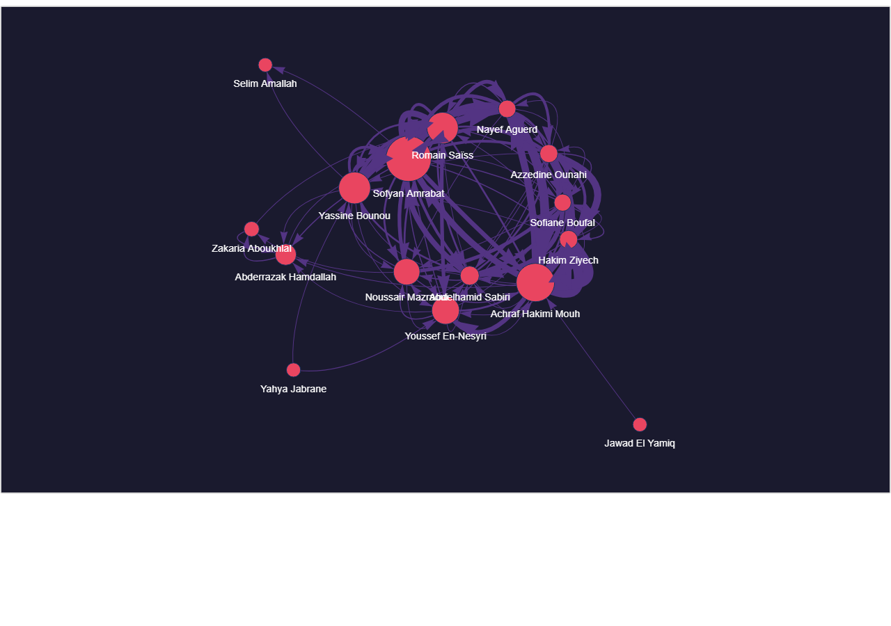

# Tactical Passing Network Analysis

[](https://github.com/alvarosalinaso/tactical-narrative-graph-analysis/actions/workflows/ci.yml) [](LICENSE) [](https://python.org)



> Screenshot of the interactive per-team graph (Morocco). The interactive graph (`output/grafo_tactico.html`) is deployable via GitHub Pages.

---

## What is this?

EN: Network graph analysis on real football passing data to reveal tactical patterns that traditional stats miss. Uses StatsBomb Open Data (event-level passes with actual player names and locations) to construct directed graphs and calculate centrality metrics.

ES: Análisis de grafos de red sobre datos reales de pases de fútbol para revelar patrones tácticos que las estadísticas tradicionales no muestran. Usa datos abiertos de StatsBomb (pases a nivel de evento con nombres reales de jugadores y ubicaciones) para construir grafos dirigidos y calcular métricas de centralidad.

---

## Data Source & Attribution

**StatsBomb Open Data** (mandatory attribution) — Free, event-level football data.
The data is made available by StatsBomb under the [StatsBomb Open Data License](https://github.com/statsbomb/open-data/blob/master/LICENSE.md),
which requires that any published analysis or derivative work credits StatsBomb as the data source. Please cite StatsBomb when reusing or referencing this dataset.

- Real pass events with player names, locations, and outcomes
- World Cup 2022 match: Canada vs Morocco (match_id 3857276, 2022-12-01)
- **Only completed passes are kept as edges** (failed passes are excluded), one directed graph per team

---

## Questions I asked

**P1 - Single Point of Failure:** Is there a player whose removal would collapse the team's possession network? Betweenness centrality identifies these structural vulnerabilities.

**P2 - Traffic monopolies:** Does one player concentrate a disproportionate share of transitional traffic? Opponents can target this player to disrupt buildup.

**P3 - Failed connections:** Are there missing links between midfielders and forwards that traditional stats don't show? The graph reveals where tactical communication breaks down.

---

## How it works

### 1. Graph construction

`src/graph_builder.py` builds a `nx.DiGraph` from StatsBomb passing events:
- **Nodes** = players (real names from match data)
- **Directed edges** = actual pass direction between players
- **Edge weight** = accumulated pass frequency

### 2. Centrality metrics

| Metric | What it measures |
|--------|-----------------|
| **Betweenness Centrality** | Who acts as indispensable bridge (the SPOF) |
| **PageRank** | Who is most connected in the passing network |
| **In/Out Degree** | Ball reception vs distribution volume |

**Centrality variants — which is which:**

- **Betweenness unweighted** (`top_betweenness`): every pass hop counts as 1. Answers "who sits on the most minimum-hop paths" — this is the one used for node size in the interactive graph and for the headline rankings.
- **Betweenness weighted** (`top_betweenness_weighted`, distance = 1/weight): frequent pass lanes become *short* edges, so shortest paths prefer high-frequency connections. Answers "who bridges the frequent-pass cores". NetworkX treats `weight` as distance, hence the inversion.
- **PageRank / degree**: use pass frequency as weight (frequency = importance).

The pipeline has no synthetic fallback: without `data/raw/statsbomb_passes.csv` it stops with a warning and builds nothing, so no centrality can come from fabricated edges. The old `passing.csv` FBref/United fallback was removed.

### 3. Interactive visualization

PyVis renders the graph as an interactive HTML file (`output/grafo_tactico.html`) with force-directed layout. Node size reflects betweenness centrality.

---

## Key findings (per team — Canada vs Morocco, match 3857276)

Each figure below is recomputed from the regenerated per-team outputs (sources in parentheses).

**Morocco** (`flourish_arc_diagram_morocco_network_metrics.json`, `flourish_arc_diagram_morocco.csv`)
- 16 players, 100 aggregated passing edges from 310 completed passes, 3 communities
- Sofyan Amrabat has the highest betweenness (0.1100, unweighted) — key connector; Achraf Hakimi Mouh leads PageRank (0.1244)

**Canada** (`flourish_arc_diagram_canada_network_metrics.json`, `flourish_arc_diagram_canada.csv`)
- 16 players, 140 aggregated passing edges from 480 completed passes, 3 communities
- Tajon Buchanan has the highest betweenness (0.0740, unweighted); Kamal Miller leads PageRank (0.1380)

**Match totals** (`data/raw/statsbomb_passes.csv`)
- 869 pass events → 790 completed (79 failed excluded) → 240 aggregated edges across both teams
- Completed passes by length: 140 short (<10 m), 449 medium (10–25 m), 201 long (≥25 m) — medium/short dominate possession phases, long balls appear in transitions

---

## How to run

```bash
git clone https://github.com/alvarosalinaso/tactical-narrative-graph-analysis
cd tactical-narrative-graph-analysis
python -m venv .venv
source .venv/bin/activate  # Linux/Mac
pip install -r requirements.txt
python src/graph_builder.py
```

Open `output/grafo_tactico.html` in your browser.

---

## Dependencies

```
networkx>=3.0
pyvis>=0.3
pandas>=2.0
statsbombpy>=1.0
```

---

## Related projects

- [Manchester United Analysis](https://github.com/alvarosalinaso/manchester-united-analisis) — Causal analysis of managerial changes
- [Chilean Video Games](https://github.com/alvarosalinaso/chilean-videogames-analysis) — Market analysis with scraping
- [World Cup 2026](https://github.com/alvarosalinaso/worldcup-2026) — Interactive dashboard

---

> **Álvaro Salinas Ortiz**
> [LinkedIn](https://www.linkedin.com/in/alvaro-salinas-ortiz) | [Portfolio](https://alvarosalinaso.github.io/portfolio-web/)
